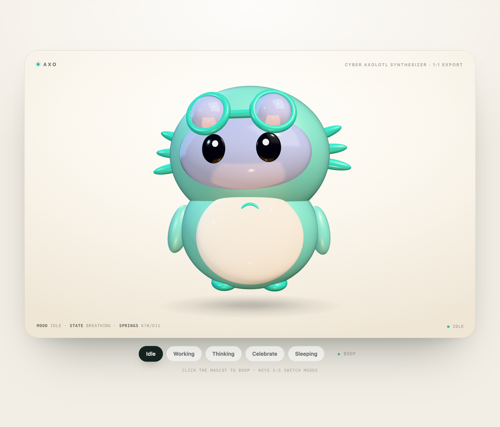
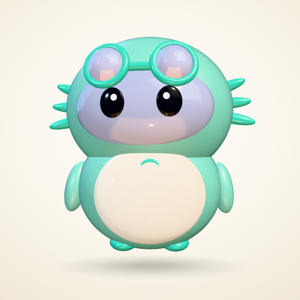
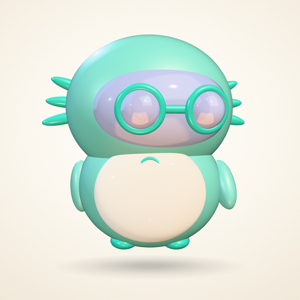
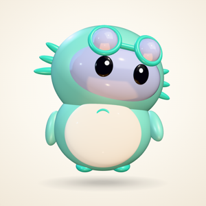
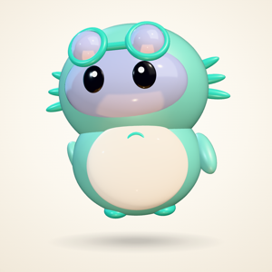
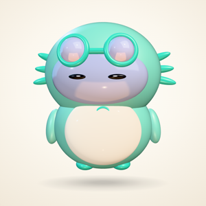
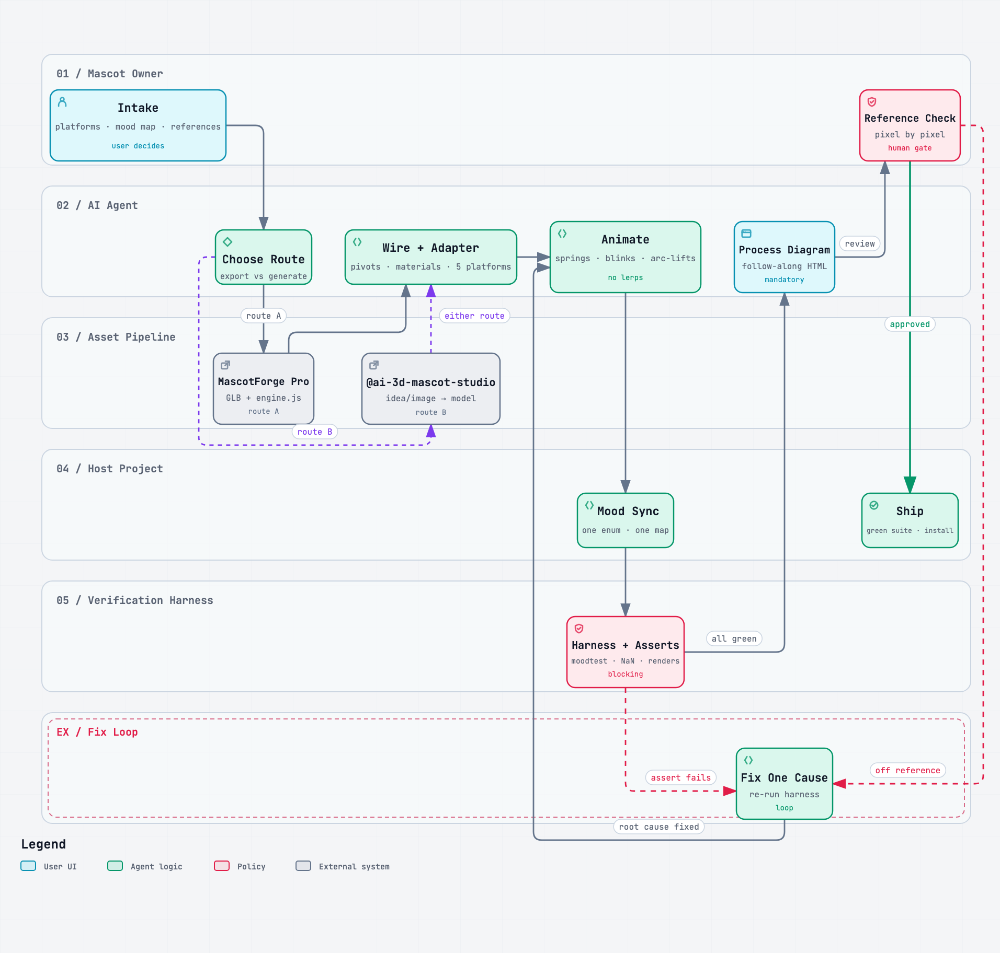

<p align="center">
  
</p>

<h1 align="center">FlyMascots</h1>

<p align="center">
  <b>Give your project a mascot that feels alive.</b><br>
  An agent skill that takes a mascot from an idea, an image or a MascotForge&nbsp;Pro export to a spring-animated character synced to your app's state — and verifies it before you see it.
</p>

<p align="center">
  <code>npx skills add Ravinder82/FlyMascots</code> &nbsp;·&nbsp;
  <a href="https://www.npmjs.com/package/flymascots">npm&nbsp;·&nbsp;v1.0.1</a> &nbsp;·&nbsp; MIT
</p>

---

## The 24-second reel

The whole thing, cut on the beat — five moods, verification, install. Every
frame is the real viewer; nothing is a mockup.

<p align="center">
  <video src="assets/reel-24s.mp4" poster="assets/reel-poster.png" width="720" controls muted loop playsinline></video>
</p>

<sub>Direct file: <a href="assets/reel-24s.mp4">24 s reel (MP4, 3.3 MB)</a> · Also rendered: <a href="marketing/renders/flymascots-story-16x9.mp4">story cut, 34 s</a> · <a href="marketing/renders/flymascots-reel-9x16.mp4">9:16 vertical</a> · <a href="marketing/renders/flymascots-story-9x16.mp4">story 9:16</a>.</sub>

## Five moods, one enum

It breathes, blinks on its own timer, looks around, and bounces with spring
physics — never a linear slide. Your app decides which mood it's in, and the
character catches up with a spring (70 k / 11 d on the head).

<p align="center">
  
  
  
  
  
</p>
<p align="center"><sub><b>idle</b> · <b>working</b> · <b>think</b> · <b>celebrate</b> · <b>sleep</b> — captured from the viewer, one still each</sub></p>

In the Axo build for DayPilot the mapping is one switch statement:

| Your app does | Axo does |
| --- | --- |
| start / resume a run | `working` — goggles drop, arms to the keyboard |
| pause | `idle` — goggles up, drifting |
| stop | `think` — head tilt, hand to the chin |
| quit | `celebrate` — hop, hands out |

## What a run produces

Every run ends with a process diagram of *this* project's pipeline — open it in
a browser and follow the run step by step. This is the diagram from the Axo run:

<p align="center">
  <picture>
    <source media="(prefers-color-scheme: dark)" srcset="assets/pipeline-dark.png">
    
  </picture>
</p>

## Install & use

```bash
npx skills add Ravinder82/FlyMascots     # skills CLI
npm i flymascots                         # or vendor the package (v1.0.1, MIT)
```

Then ask your agent:

```
@flymascots add a mascot to <project> from this image — it should feel alive
and reflect my app's states
```

Triggers: *"add a mascot"*, *"create a mascot from this idea/image"*, *"port my
MascotForge GLB"*, *"make the mascot feel alive"*, *"sync the mascot with app
states"*, *"clone my mascot reference exactly"*.

## It works in five kinds of projects

| Target | Route |
| --- | --- |
| Website | Three.js — `mascot-engine.js` runs as-is, or load your GLB |
| macOS / iOS | Swift + SceneKit — port the pose table (the DayPilot pattern) |
| React Native / Expo | transparent `WebView` around the same engine, or `expo-three` |
| Blog / static page | a short loop as SVG / Lottie / GIF — pose table, no springs |
| Desktop (Electron) | the web runtime in a transparent, click-through window |

Details per platform: [`references/platforms.md`](skills/flymascots/references/platforms.md).

## Verified, not vibes

Nothing goes to you until it passes ([`references/verification.md`](skills/flymascots/references/verification.md)):

- **Numeric mood assertions** — every mood driven through the real tick loop:
  working goggle `0.440`, arms `−0.48/+0.18`; think armR `−0.780`; celebrate
  armL `< −0.40`, hop `0.167`; sleep eyes `0.080`.
- **60-transition health check** — rapid-cycle the mood enum, then assert
  `pivotsFinite()`: no NaN, no vanished limbs.
- **Pose renders with the anti-blink rule** — snapshots come from the same
  scene-builder the app uses, retried until the eyes are open; each pose is
  compared side by side with your reference image, colours sampled from it.

## What's inside

```
skills/flymascots/
  SKILL.md                     # the pipeline: 9 steps + guardrails
  references/
    platforms.md               # 5 integration routes, one per kind of project
    animation-physics.md       # how it moves, the mood poses, the numbers
    verification.md            # the test lab: assertions, snapshots, captures
    daypilot-case-study.md     # how Axo was actually built, file by file
diagrams/
  mascot-pipeline.html         # the process diagram (interactive)
site/
  axo-stage.html               # the Axo stage viewer — real engine, 5 moods
marketing/                     # every launch asset, generated from the viewer
assets/                        # stills + the 24 s reel used by this README
```

## Made with it: Axo

Axo runs in [DayPilot](https://github.com/Ravinder82/DayPilot) on macOS
(SceneKit) — same pose table, native springs, live window capture in the test
lab. The full build log is
[`references/daypilot-case-study.md`](skills/flymascots/references/daypilot-case-study.md).

## Marketing kit

Everything in `marketing/` is real output: stills and film frames captured from
`site/axo-stage.html`, the pipeline exported by the diagram's own menu, music
and SFX with documented licences, and films cut on a measured beat grid. How to
regenerate it — and the QC/sound results — is in
[`marketing/README.md`](marketing/README.md).

## License

[MIT](LICENSE) © Ravinder Poonia
