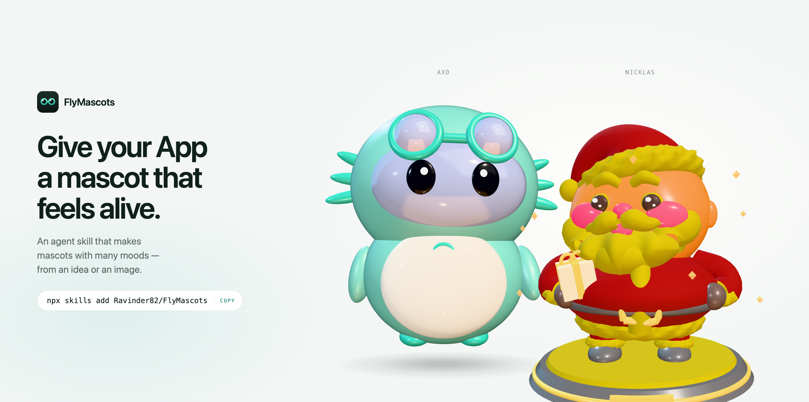
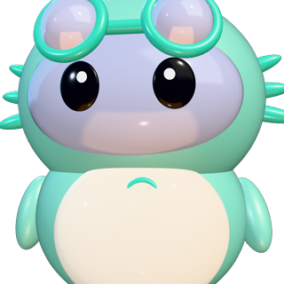
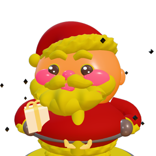
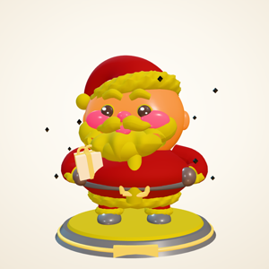
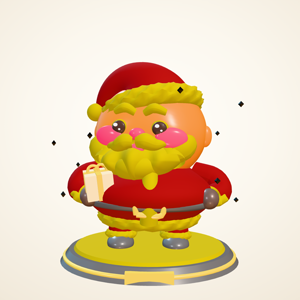
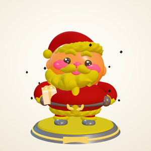
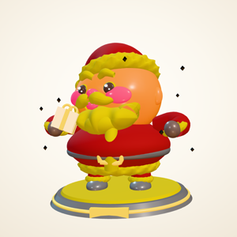
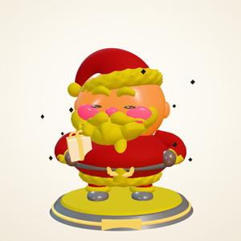

<p align="center">
  
</p>

# FlyMascots

**Give your project a mascot that feels alive.**

An agent skill that takes a mascot from an idea, an image, or a MascotForge export and turns it into a breathing, blinking character that changes mood with your app — verified before you ever see it.

The characters live in a small library: one entry each, built in code or loaded from a sculpt, all answering the same five words.

## How it works

Three steps, and the third is a word.

### 1. Add the skills
Two land beside your coding agent — **flymascots** (the whole pipeline) and **ai-3d-mascot-studio** (sculpts the character from your idea or image) — ready whenever you want a character in your product.

```
npx skills add Ravinder82/FlyMascots
```

### 2. Bring a mascot
Start with an idea in a sentence, an image you already have, or a MascotForge export. The skill builds it into a real, jointed character.

### 3. Say the word
Your app sets one of five words — **idle, working, think, celebrate, sleep** — and the mascot does the rest.

```js
setMood("working")
```

## Install & run

```bash
# With the skills CLI
npx skills add Ravinder82/FlyMascots

# Or vendor the package
npm i flymascots   # v1.2.0, MIT
```

Then ask your agent:

```
@flymascots add a mascot to <project> from this image — it should feel alive
and reflect my app's states
```

## Five moods, one word each

Real footage of the character, caught mid-mood.

<p align="center">
  
  
  
  
  
</p>

<sub><b>idle</b> · <b>working</b> · <b>think</b> · <b>celebrate</b> · <b>sleep</b> — five moods, one word each</sub>

## The cast

Two characters ship in the library, and both answer the same five words. The landing page lets you swap between them and the mood footage follows.

<p align="center">
  
  
</p>

<sub><b>Axo</b> — the demo character, built in code by the skill itself · <b>Nicklas</b> — a 24K gold sculpt exported straight out of the studio</sub>

<p align="center">
  
  
  
  
  
</p>

### Adding a character to the library

The library is one entry per character — [`site/src/mascots/index.js`](site/src/mascots/index.js). A new mascot is one entry plus one model file; the stage, the landing page and the capture rig all read from there, so nothing else has to change.

```js
export const MASCOTS = {
  axo: { kind: 'procedural', build: ({ envMap }) => buildProceduralMascot(config, envMap) },
  nicklas: { kind: 'glb', load: () => loadNicklasModel(url), build: ({ model }) => buildNicklasRig(model) },
};
```

A sculpt ships as a meshopt-compressed GLB plus a base64 wrapper, so it loads from `file://` as well as `http://`. The rigging runs at runtime — parts are addressed by mesh index and re-parented under pivots, so the head nods without touching the mesh.

```bash
# compress + package a sculpt, map its meshes, then shoot it
node marketing/tools/build-mascot-model.mjs <sculpt.glb> nicklas config.json
node marketing/tools/inspect-mascot.mjs  website/assets/mascots/nicklas/model.glb
node marketing/tools/capture-mascot.mjs   nicklas
node marketing/tools/capture-mood-loops.mjs nicklas
```

## Where it lives

Your mascot ships wherever your app does — website, macOS & iOS, React Native, static pages, and Electron — all from the same five words. Details: [`skills/flymascots/references/platforms.md`](skills/flymascots/references/platforms.md).

## License

[MIT](LICENSE) © Ravinder Poonia
